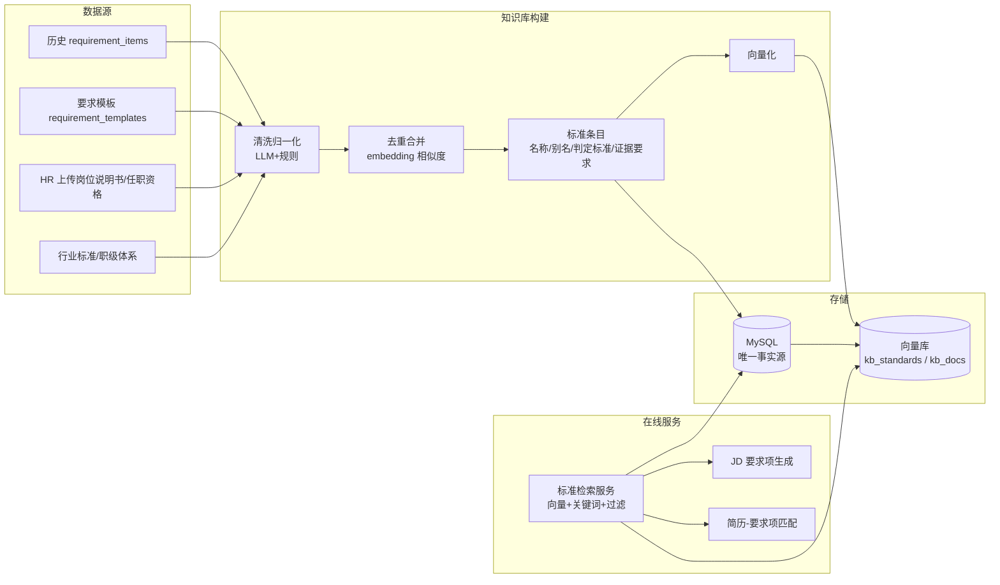

# 岗位标准知识库方案

> 适用场景：职位要求与候选人智能匹配（TalentFlow 招聘中台）
> 目标：把 LLM 每次临时生成的要求项沉淀为组织级、可复用、可追溯、可评测的岗位标准，并为简历匹配提供统一判定依据。

## 1. 目标与边界

- 知识库只存**组织级标准资料**（岗位标准条目、知识资料文档），不存候选人简历或临时 JD。
- MySQL 是唯一事实源，向量库是可随时重建的派生索引。
- RAG 只做增强：检索失败/embedding 服务异常时自动回退到现有纯 LLM 逻辑，不阻断主流程。
- LLM 输出的来源引用必须校验，不在本次注入范围内的引用一律剔除。

## 2. 总体架构



## 3. 技术选型

| 环节 | 方案 | 说明 |
| --- | --- | --- |
| Embedding | 硅基流动 `BAAI/bge-m3`（OpenAI 兼容接口） | 1024 维，中文语义效果好，按量计费 |
| 向量库 | Chroma 持久化（`data/vector_store/`） | 单机零运维；数据量超百万 chunk 或多实例并发时换 Qdrant / Milvus |
| 关键词检索 | 标准名称/别名精确匹配加权 | 一期不引入分词依赖，中文标准条目量级小，足够用 |
| 排序融合 | 向量相似度为主，名称/别名命中加权 | 二期再引入 BM25 + RRF + reranker |
| 生成模型 | 现有 `ModelClient`（OpenAI 兼容） | 复用重试、超时、token 上限与结构化日志 |
| 文档解析 | 现有 pypdf/docx + OCR 兜底 | 知识资料复用同一解析链 |
| 可观测 | 现有 LLM 结构化日志 | `retrieval_ids` 记录本次命中的标准 id |

依赖：`chromadb`、`numpy` 已在环境中可用；`requirements.txt` 需补充声明。

## 4. 数据模型

| 表 | 关键字段 | 作用 |
| --- | --- | --- |
| `kb_standards` | `id, code, name, category, level, type, importance, standard, required_evidence, negative_signals, aliases, job_family, source, status, version, embedding_model, updated_at` | 岗位标准条目，草稿→发布→归档 |
| `kb_docs`（二期） | `id, title, category, source_type, file_path, version, status` | 知识资料文件 |
| `kb_chunks`（二期） | `id, doc_id, chunk_no, content, token_count, metadata` | 文档切块，对应 `kb_docs` 集合 |
| `requirement_items`（改造） | 新增 `standard_id`（可空，FK） | 要求项关联标准条目，来源可追溯 |

向量元数据统一携带 `standard_id / code / category / level / status / version`，检索只查 `status=published`，避免草稿进入 Prompt。

## 5. 知识库构建流程

1. **采集**：历史 `requirement_items`、要求模板、HR 上传资料、行业标准。
2. **归一化**：LLM + 规则把「Python 基础 / 熟悉 Python / Python 开发经验」合并为同一标准，生成 `aliases`。
3. **去重**：名称与别名完全相同的合并；embedding 相似度 > 0.9 提示人工确认合并。
4. **审核发布**：草稿 → 审核 → 发布；只有 `published` 参与检索。
5. **向量化**：`name + aliases + standard + category` 拼接后 embedding，写入 `kb_standards` 集合；按 `updated_at` 增量重建，提供全量重建入口。

## 6. 在线链路

### 6.1 JD 要求项生成

1. 职位 JD 文本 → embedding → 检索 Top-K（默认 3）已发布标准（阈值默认 0.75）。
2. 注入 Prompt：「岗位标准参考」列表，含 `standard_id`、名称、判定标准、证据要求。
3. LLM 输出要求项时优先复用标准名称与判定标准，并返回 `standard_id`。
4. **引用校验**：`standard_id` 不在本次注入集合内直接剔除；无命中时降级为现有纯 LLM 生成。
5. 生成结果中携带 `standard_id`，批量落库后要求项与标准建立关联。

### 6.2 简历匹配

1. 取职位要求项，按 `standard_id` 关联标准条目。
2. 在简历解析 Prompt 的「要求项列表」中追加该标准的判定标准与必需证据。
3. LLM 输出 `suggestion + evidence`，evidence 必须引用简历原文；空证据仍按现有规则过滤。
4. 本次使用的标准 id 写入 LLM 结构化日志的 `retrieval_ids`，可追溯「匹配依据来自哪一版标准」。

## 7. 接口设计

| 方法 | 路径 | 说明 |
| --- | --- | --- |
| GET | `/kb/standards` | 标准条目列表（支持关键字、分类、状态筛选） |
| POST | `/kb/standards` | 新建标准（草稿） |
| PUT | `/kb/standards/{id}` | 更新标准（发布后变更需升版本） |
| POST | `/kb/standards/{id}/publish` | 发布并向量化 |
| POST | `/kb/standards/{id}/archive` | 归档并删除向量 |
| DELETE | `/kb/standards/{id}` | 删除标准 |
| GET | `/kb/search?q=&top_k=` | 标准检索（调试与前端预览） |
| POST | `/kb/import/requirements` | 从历史要求项沉淀标准（去重后入草稿） |
| POST | `/kb/reindex` | 全量重建向量索引 |

## 8. 配置项

```bash
RAG_ENABLED=true
RAG_TOP_K=3
RAG_MIN_SCORE=0.60
EMBEDDING_MODEL=text-embedding-v4
EMBEDDING_API_BASE=https://dashscope.aliyuncs.com/compatible-mode/v1
EMBEDDING_API_KEY=sk-xxx
VECTOR_STORE_BACKEND=chroma
VECTOR_STORE_PATH=data/vector_store
RAG_REBUILD_BATCH=32
```

`RAG_ENABLED=false` 或 `VECTOR_STORE_BACKEND=null` 时走降级链路，行为与改造前一致。

## 9. 分阶段实施

| 阶段 | 内容 | 验收 |
| --- | --- | --- |
| P0 | 数据盘点：历史要求项分布与重复率 | 输出语料统计 |
| P1 | 知识库 CRUD + 发布向量化 + 检索服务 + 重建脚本 | `/kb/search` 可用，检索命中合理 |
| P2 | JD 生成接入标准检索与引用校验 | 标准命中率 ≥ 60%，无标准时降级不报错 |
| P3 | 简历匹配注入判定标准 | evidence 可定位原文，空证据率下降 |
| P4 | 混合检索 + rerank、知识文档接入、前端知识库管理页 | 管理页可增删审发布、一键重建 |

## 10. 验收指标

| 指标 | 目标 |
| --- | --- |
| 标准命中率（生成要求项关联到已发布标准） | ≥ 60% |
| Recall@3（检索结果含正确标准） | ≥ 85% |
| HR 对匹配建议一致率 | 相比纯 LLM 提升 ≥ 15% |
| evidence 引用有效性 | 100% 可定位简历原文 |
| 生成链路 P95 时延增量 | ≤ +1.5s |
| 降级触发成功率 | 100%，不阻断主流程 |

## 11. 风险与应对

- **标准库质量决定上限**：保留草稿→审核→发布流程，禁止 LLM 结果直接发布。
- **重建一致性**：向量 id 使用 `standard_id`，删除/归档必须同步删向量，避免脏召回。
- **Prompt 长度**：注入内容按条数与字符数双上限截断，复用现有 `MAX_REQUIREMENTS_CHARS` 思路。
- **成本与时延**：embedding 结果按 `name+standard` 内容哈希缓存，未变更不重复调用。
- **中文专有名词**：二期引入自定义词典与 BM25，提升精确匹配。

## 12. 实施状态（本仓库已落地）

| 能力 | 状态 | 代码位置 |
| --- | --- | --- |
| 知识库配置项 | 已完成 | `app/core/config.py` |
| DashScope Embedding 封装（失败抛 `EmbeddingError`） | 已完成 | `app/rag/embedding.py` |
| Chroma 持久化向量库（cosine，`score = 1 - distance`） | 已完成 | `app/rag/chroma_store.py` |
| 向量库工厂 / 空实现降级 | 已完成 | `app/rag/__init__.py`、`app/rag/null_store.py` |
| 标准条目模型 `kb_standards` | 已完成 | `app/models/kb_standard.py` |
| `requirement_items.standard_id`（`ON DELETE SET NULL`） | 已完成 | `app/models/requirement.py`、`scripts/migrate_kb.py` |
| 仓储 / Schema / 服务 / REST | 已完成 | `app/repositories/kb_standard_repository.py`、`app/schemas/kb.py`、`app/services/kb_service.py`、`app/api/kb.py` |
| JD 生成：检索注入 + `standard_id` 引用校验 + 落库 | 已完成 | `app/services/jd_parser.py`、`app/services/requirement_service.py` |
| 简历匹配：按 `standard_id` 注入判定标准与证据要求 | 已完成 | `app/services/resume_tasks.py`、`app/services/resume_parser.py` |
| LLM 日志 `retrieval_ids` 记录命中标准 id | 已完成 | `app/core/logging_config.py`、`app/llm/callback.py` |
| 测试覆盖（CRUD/发布/沉淀/降级/检索过滤/引用校验） | 已完成 | `tests/test_kb.py` |
| 前端知识库管理页、混合检索与 rerank、知识文档 `kb_docs` | 待实施（P4） | — |

运行前注意：

1. 已有数据库执行一次 `python scripts/migrate_kb.py`（幂等）。
2. 在 `.env` 配置 `EMBEDDING_API_KEY`（DashScope），否则检索恒为空并告警降级。
3. 发布标准或全量重建后，向量才可被检索命中。
